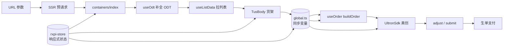

# new-list 页面架构简介

> 接送机新版商品列表页（货架页），多端（飞猪 App / 淘宝 / 支付宝 / 微信小程序 / H5）统一架构。

---

## 一句话定位

`new-list` 是一个 **SSR 首屏 + CSR 交互** 的接送机商品货架页：底层高德地图展示路线，上层可拖拽浮层展示报价列表，用户选价后通过奥创协议完成建单、调价、生单、支付。

---

## 一、整体分层（5 层）

```
┌─────────────────────────────────────┐
│  入口层：SSR 预渲染 + HSF 轮询        │  index.tsx
├─────────────────────────────────────┤
│  容器层：业务编排、生命周期、事件分发  │  containers/index.tsx
├─────────────────────────────────────┤
│  布局层：地图、浮层、锚点、视觉布局    │  containers/layout/index.tsx
├─────────────────────────────────────┤
│  组件层：货架、卡片、底部栏、弹层      │  components/*
├─────────────────────────────────────┤
│  能力层：请求、状态、订单、价格解析    │  hooks/* / store/* / service/* / utils/*
└─────────────────────────────────────┘
```

---

## 二、核心数据流（4 步）

1. **进来**：URL 参数 → SSR 校验 → HSF 轮询（最多 2 次）→ 返回首屏数据。
2. **展示**：CSR 补全 ODT 详情 → 请求报价列表 → 转换数据 → 渲染货架。
3. **选价**：用户点击报价卡片 → 更新选中项 → 触发 `buildOrder` → 初始化奥创 SDK。
4. **下单**：奥创 `adjust` / `submit` → 注入乘车人信息 → 生单 → 拉起支付。

---

## 三、状态管理

采用 **`@ali/rxpi-store`** 单一 Store，namespace 为 `list`。

| 类型 | 作用 | 代表字段 |
|------|------|----------|
| **Store 响应式状态** | 驱动视图更新 | `listResData`、`selectedPriceItem`、`listLoading` |
| **同步全局变量** | 绕过闭包延迟，供异步流程实时读取 | `curSelectPrice`、`backAndReload` |

> 为什么需要全局变量？`buildOrder` / `adjustOrder` 是异步的，store state 在回调里是旧快照，必须用同步变量拿到“当前真正选中的报价”。

---

## 四、核心 Hook 职责

| Hook | 一句话说明 |
|------|-----------|
| `useListData` | 拉列表、SSR 缓存命中、轮询、重置货架 |
| `useOdt` | 把 URL 里的短参数换成 POI 详情 |
| `useSelectPrice` | 切换报价、重置旧报价、解析奥创返回的新价格 |
| `useOrder` | 建单、调价、生单、支付 |
| `useMapData` | 把行程数据转成地图 markers 和视角 padding |

---

## 五、关键业务概念

- **ODT**：出发地（Origin）、目的地（Destination）、用车时间（Time）。
- **货架（TusBody）**：左侧车型分类 Tab + 右侧报价卡片列表 + 顶部优惠区块。
- **奥创（Ultron）**：交易协议 SDK，负责价格明细、优惠券、权益、生单协议。
- **选价**：每次用户切报价，旧报价价格重置为初始值，新报价进入 `buildOrder`。

---

## 六、简化架构图



---

## 七、向别人介绍的开场白（可直接用）

> “`new-list` 是接送机的报价列表页，整体是 SSR 首屏加 CSR 交互。页面分五层：入口做 SSR 预渲染，容器层做业务编排，布局层管地图和浮层，组件层是货架和底部操作栏，底层用 hooks + store 做数据、状态和订单流程。状态方面我们用了 rxpi-store 驱动视图，同时用一个同步全局变量来绕过异步闭包问题，保证 build/adjust 时能读到实时选中的报价。用户流程就是：看列表 → 选报价 → 奥创建单 → 选券/权益 → 生单支付。”
